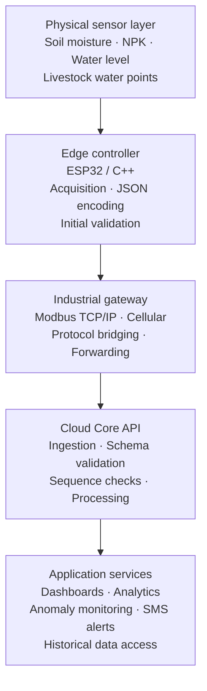

# KIOTA IoT Telemetry Core

**A scalable telemetry ingestion and processing foundation for smart agriculture and industrial IoT.**

[](#project-status)
[](#technology-stack)
[](#technology-stack)
[](#telemetry-processing)

KIOTA IoT Telemetry Core is an open-source project intended to provide a reliable foundation for collecting, validating, processing, and analyzing sensor telemetry from distributed agricultural and industrial environments.

The proposed system connects field sensors and embedded controllers to gateway infrastructure and cloud-based services. Its design priorities are **efficient stream processing, clear validation boundaries, interoperability, observability, and extensibility**.

> **Project status:** This repository currently documents the proposed architecture and engineering direction. A production-ready ingestion service, device firmware, deployment manifests, and automated tests have not yet been included. Capabilities described as design goals should not be interpreted as implemented features.

## Contents

- [Objectives](#objectives)
- [System architecture](#system-architecture)
- [Telemetry processing](#telemetry-processing)
- [Technology stack](#technology-stack)
- [Security, reliability, and governance](#security-reliability-and-governance)
- [Target applications](#target-applications)
- [Repository roadmap](#repository-roadmap)
- [Getting started](#getting-started)
- [Contributing](#contributing)
- [Project leadership](#project-leadership)
- [License](#license)

## Objectives

The project aims to:

- Ingest telemetry from distributed sensor nodes.
- Validate message structure, device identity, timestamps, and sequence information.
- Process incoming records with predictable resource usage.
- Provide integration points for dashboards, analytics, and alerting systems.
- Support deployments ranging from small agricultural sites to larger industrial installations.

## System architecture

The reference architecture separates physical sensing, edge acquisition, transport, cloud ingestion, and application services.



### Data flow

1. **Sense:** field devices collect measurements from connected sensors.
2. **Acquire:** an edge controller reads sensor values and creates a structured telemetry message.
3. **Transport:** a gateway forwards data using the configured network and protocol.
4. **Ingest:** the cloud API authenticates the sender and validates the message.
5. **Process:** accepted records are normalized, checked, stored, and made available to downstream services.
6. **Act:** application services visualize measurements and may trigger configured alerts.

The diagram is a logical reference architecture. Actual transport choices, protocol gateways, storage systems, and deployment topology will be defined by each implementation.

## Telemetry processing

The processing design favors a streaming approach: validate each incoming record as it arrives instead of sorting the complete stream when sorting is not required.

### Sequential evaluation

For a stream containing `n` records, a single-pass validation routine can achieve:

- **Time complexity:** `O(n)` when each record requires a bounded amount of work.
- **Auxiliary space:** `O(1)` for a fixed-size accumulator or invariant check, excluding the input message, buffers, queues, indexes, and any state retained for deduplication or reordering.

Actual memory use depends on buffering, batching, persistence, and the validation features enabled.

### Arithmetic summation invariant

For a known sequence of expected integer identifiers, the expected sum can be compared with the observed sum. This can reveal some missing or inconsistent values when the sequence boundaries and uniqueness assumptions are known.

Implementation considerations:

- Use an integer width large enough for the maximum supported range.
- Check for overflow before performing arithmetic.
- Define the expected identifier range and reset/window boundaries.
- Do not use a sum comparison as a complete packet-integrity mechanism.

### Bitwise XOR invariant

XOR has the property:

```text
x XOR x = 0
x XOR 0 = x
```

Consequently, equal values cancel in an XOR aggregate. Comparing expected and observed XOR values can help identify certain sequence discrepancies under clearly defined assumptions.

### Important validation limitation

Summation and XOR are lightweight, complementary checks—not cryptographic checksums and not complete proofs of telemetry integrity. Different error patterns can produce the same aggregate result. A robust implementation should combine them, where appropriate, with:

- Unique device and message identifiers.
- Monotonic sequence numbers or explicitly defined sequence windows.
- Timestamps and clock-quality checks.
- Payload schema and range validation.
- Transport-level checksums and application-level message authentication.
- Duplicate detection, retry handling, and replay protection.
- Durable storage and audit logs where required.

## Technology stack

The following technologies describe the intended integration environment; they are not all implemented in this repository yet.

| Area | Intended technology / approach |
|---|---|
| Edge computing | ESP32-class microcontrollers |
| Embedded software | C++ |
| Backend services | Java and/or Python |
| API style | REST |
| Field / gateway communication | Modbus TCP/IP where supported |
| Telemetry encoding | JSON |
| Connectivity | Cellular and IP networks |
| Processing | Sequential stream evaluation |
| Validation | Schema checks, sequence metadata, and mathematical invariants |
| Monitoring | Web dashboards and operational metrics |
| Notifications | SMS integration through a selected provider |

The final implementation may select one backend language and add message brokers, databases, authentication providers, and deployment tooling based on measured requirements.

## Security, reliability, and governance

Security and reliability are design requirements for any deployment. Planned engineering controls include:

- **Authentication and authorization:** device identity, service credentials, and role-based access control (RBAC).
- **Transport security:** encrypted connections such as TLS wherever supported.
- **Telemetry validation:** schema, bounds, timestamp, sequence, and device checks.
- **Secrets management:** keep credentials and private keys out of source control.
- **Data governance:** documented retention, access, export, and deletion policies.
- **Observability:** structured logs, metrics, health checks, and traceable error handling.
- **Resilience:** bounded queues, retry policies, idempotent processing, and recovery procedures.
- **Scalability:** load testing and capacity planning for expected device counts and message rates.

These controls must be implemented and verified before the system is used in production.

## Target applications

- **Smart agriculture:** soil moisture and nutrient telemetry.
- **Precision irrigation:** monitoring conditions relevant to irrigation decisions.
- **Livestock infrastructure:** water availability and distribution-point monitoring.
- **Environmental monitoring:** distributed environmental measurements.
- **Industrial IoT:** centralized visibility into connected sensors and equipment.

## Repository roadmap

The following staged roadmap provides a practical path from architecture to a deployable system.

- [ ] Define telemetry message schema and versioning policy.
- [ ] Implement a minimal ingestion API.
- [ ] Add device authentication and authorization.
- [ ] Implement validation, sequence tracking, and duplicate handling.
- [ ] Add automated unit and integration tests.
- [ ] Add persistent storage and retention configuration.
- [ ] Add metrics, structured logging, and health endpoints.
- [ ] Provide ESP32 example firmware.
- [ ] Add gateway / Modbus integration examples.
- [ ] Add containerized local development and deployment documentation.
- [ ] Add dashboard and alerting integrations.
- [ ] Run performance, security, and failure-recovery tests.

## Getting started

This repository is currently an architecture and project-documentation foundation; there is no runnable telemetry server or firmware release yet.

To begin development:

1. Clone the repository.
2. Review the architecture and telemetry requirements in `docs/`.
3. Agree on the initial backend language and message schema.
4. Implement a minimal ingestion endpoint and tests before connecting live devices.

```bash
git clone https://github.com/<YOUR-GITHUB-USERNAME>/kiota-iot-telemetry-core.git
cd kiota-iot-telemetry-core
```

Replace `<YOUR-GITHUB-USERNAME>` with the GitHub account or organization that will host the repository.

## Contributing

Contributions, design reviews, bug reports, and implementation proposals are welcome. Please read [CONTRIBUTING.md](CONTRIBUTING.md) before opening a pull request.

For security-sensitive reports, follow [SECURITY.md](SECURITY.md) and avoid publishing exploitable details in a public issue.

## Project leadership

**Samson Leonard Mvumba**  
Founder & CEO — **KIOTA Framework**

Building intelligent infrastructure through embedded systems, computational engineering, and scalable IoT technologies.

## License

No license has been selected for this repository yet. Until a license is added, the default copyright rules apply and reuse, modification, and redistribution are not automatically permitted.

Before publishing, choose an open-source license that matches the project's goals and add its complete text as `LICENSE`. See [Choose an open-source license](https://choosealicense.com/) for guidance.
